  <table>
    <tr>
      <td align="center" valign="middle">
        <picture>
          <source media="(prefers-color-scheme: dark)" srcset="./ppascii.gif" />
          <source media="(prefers-color-scheme: light)" srcset="./ppascii-light.gif" />
          
        </picture>
      </td>
      <td align="center" valign="middle">
        <picture>
          <source media="(prefers-color-scheme: dark)" srcset="./terminal-dark.svg" />
          <source media="(prefers-color-scheme: light)" srcset="./terminal-light.svg" />
          
        </picture>
      </td>
    </tr>
  </table>
   
  

    <a href="https://github.com/ppolkadot?tab=repositories"><kbd>&nbsp;repositories&nbsp;</kbd></a>
    &nbsp;&nbsp;
    <a href="https://github.com/ppolkadot?tab=stars"><kbd>&nbsp;stars&nbsp;</kbd></a>
  

