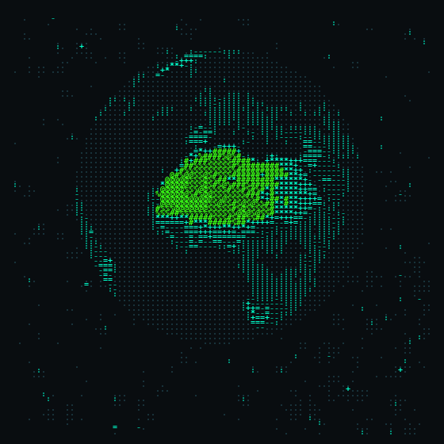

  <picture>
    <source media="(prefers-color-scheme: dark)" srcset="./ppascii.gif" />
    <source media="(prefers-color-scheme: light)" srcset="./ppascii-light.gif" />
    
  </picture>

<!--
**ppolkadot/ppolkadot** is a ✨ _special_ ✨ repository because its `README.md` (this file) appears on your GitHub profile.
...
-->